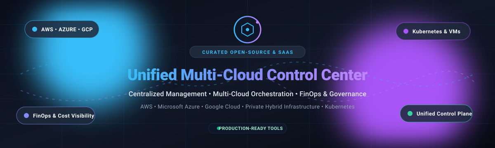

# Awesome-Unified-Multi-Cloud-Control-Center

  

# 🌐 Awesome Unified Multi-Cloud Control Center 🚀

  
  
  
  
  
  

> 🧭 A meticulously curated directory of top **Unified Multi-Cloud Control Center** platforms, hybrid-cloud orchestration planes, FinOps cost observability engines, and self-hosted open-source control suites across AWS, Microsoft Azure, Google Cloud Platform (GCP), Kubernetes, and on-premises virtualization.  
> 🌟 **Star this repository** if you find it helpful for your infrastructure journey! 🌟

---

## 📋 Table of Contents 📑

- [📈 Sector Overview & Market Dynamics](#-sector-overview--market-dynamics)
- [🟦 SaaS / Hosted Platforms](#-saas--hosted-platforms)
- [🟩 Open-Source Software](#-open-source-software)
  - [Portainer](#-portainer)
  - [Rancher](#-rancher)
  - [Infracost](#-infracost)
  - [Crossplane](#-crossplane)
  - [OpenCost](#-opencost)
  - [OpenStack](#-openstack)
  - [Apache CloudStack](#-apache-cloudstack)
  - [Cloudpods](#-cloudpods)
  - [ManageIQ](#-manageiq)
  - [Fulcrum Core](#-fulcrum-core)
  - [OpenQRM](#-openqrm)
  - [Spancloud](#-spancloud)
- [📊 Comparison at a Glance](#-comparison-at-a-glance)
- [🤝 Contributing](#-contributing)
- [💖 Support & Sponsorship](#-support--sponsorship)
- [📈 Star History](#-star-history)
- [📄 License](#-license)

---

## 📈 Sector Overview & Market Dynamics 📊

The global multi-cloud management market is estimated at approximately **$16B–$17B** and projected to surpass **$85B–$95B+ by 2034** at an impressive compound annual growth rate (CAGR) exceeding **21–22%**. The sector is **moderately fragmented yet increasingly concentrated at the enterprise top**—while dozens of nimble point-solution startups compete in FinOps, cloud governance, and container scheduling, comprehensive enterprise adoption is anchored by heavyweight infrastructure giants (such as IBM, Microsoft, and HPE) and consolidated data resilience platforms actively acquiring point tools to form unified hybrid control planes.

---

## 🟦 SaaS / Hosted Platforms ☁️

Commercial, cloud-hosted Unified Multi-Cloud Control Center platforms providing single-pane-of-glass operations. Sorted in descending order by parent company scale (valuation / market capitalization / revenue).

| Product | Parent / Company | Company Scale (Valuation / Revenue) 🏢 | Starting Pricing Tier 💳 | Free Tier / Trial Limit ⏱️ | Key Focus & Capabilities 🎯 |
|---|---|---|---|---|---|
| **Turbonomic** | IBM | ~$240B Market Cap (~$62B Rev) | Starting from ~£60/VM/mo (custom enterprise tiers start ~$3,000/mo) | 30-day free trial (unlimited workload optimization across AWS/Azure/GCP; no credit card required) | AI-driven hybrid cloud resource optimization & automated right-sizing |
| **Morpheus Data** | Hewlett Packard Enterprise (HPE) | ~$28B Market Cap (~$29B Rev) | Starting at $600/socket (VM Essentials) / $2,500/socket (Enterprise; public cloud factored at 15 WLE/socket) | 60-day free trial (VM Essentials); Free Community Edition up to 3 sockets (non-production) | Unified hybrid cloud provisioning, self-service catalog, & multi-cloud orchestration |
| **CloudCheckr** | NetApp / Flexera | ~$27B Market Cap (NetApp) / Flexera | Starting from ~3.5% of managed cloud spend (with a $500/month baseline minimum via AWS Marketplace) | 14-day free trial available via partner network/channel requests | Multi-cloud cost allocation, billing analytics, and governance posture across AWS, Azure, & GCP |
| **Rubrik Security Cloud Console** | Rubrik | ~$15B Market Cap (~$800M+ ARR) | Starting from ~$1.70–$3.60/user/mo for SaaS workloads; capacity tiers scale on enterprise contracts | 30-day free trial (limited to 500 users and up to 10 TB data capacity for SaaS protection) | Zero-trust data security, immutable cloud backups, ransomware defense, & governance |
| **Veeam Service Provider Console** | Veeam Software | ~$15B Valuation (~$2B ARR) | Console software is 100% free; managed workloads start from ~$2.63–$3.50/user/mo or ~$155–$227/workload/yr | Free console tier forever for VCSP partners; 30-day free trial on Veeam Data Platform / Cloud workloads | Centralized multi-tenant console for MSPs managing BaaS, DRaaS, & cloud backup repositories |
| **Cohesity Helios** | Cohesity (merged w/ Veritas Enterprise) | ~$7B Valuation (~$1.7B Rev) | Capacity-based starting packages (enterprise Front-End TB licensing; entry blocks from ~$29,000/yr) | 30-day free trial (DataProtect as a Service with full feature access and 30-day data retention) | SaaS data management control plane, predictive intelligence, and multi-cluster monitoring |
| **Datto Partner Portal** | Kaseya (Datto) | ~$6.2B Acquisition / ~$1.5B ARR | Starting from ~$2.00 to $3.00/user/month (MSP tiered volume contracts) | 14-day free trial (full access to Datto SaaS Protection for M365 and Google Workspace) | MSP multi-tenant control center for SaaS workload backup, rapid restore, and compliance |
| **Commvault Command Center** | Commvault Systems | ~$5.5B Market Cap (~$900M Rev) | Starting at $1.70/user/mo (M365 Standard), $3.60/user/mo (Enterprise), or from $58.50/TB/mo | 30-day free trial (full Commvault Cloud/Metallic features, up to 1 TB storage or user quota; no credit card required) | Single pane of glass for hybrid cloud data protection, policy automation, & workload recovery |
| **Acronis Management Console** | Acronis (EQT majority) | ~$3.5B+ Valuation (~$420M ARR) | Starting from £0.50–£1.45/seat/mo or £2.45–£3.55/VM/mo (UK G-Cloud framework baseline) | 30-day free trial (unrestricted access to Cyber Protect Cloud features across endpoints & cloud workloads) | MSP-centric unified backup, cybersecurity, remote endpoint monitoring, & disaster recovery |
| **Druva Control Center** | Druva | ~$2.0B Valuation (~$200M+ ARR) | Starting at $8.00/user/month for SaaS/endpoint protection; consumption storage from $2.50/TB-month | 30-day free trial (full SaaS platform access across cloud & endpoint workloads; no credit card required) | 100% SaaS-based multi-cloud data protection, global deduplication, and ransomware recovery |

---

## 🟩 Open-Source Software 🔓

Self-hosted, community-driven Unified Multi-Cloud Control Center platforms, container orchestration panes, cloud cost monitors, and hypervisor management solutions. Sorted in **descending order by GitHub star count**.

### 🐳 Portainer
  
**Stack:** Go / TypeScript / Docker | **License:** zlib / Business Edition  
[Portainer](https://github.com/portainer/portainer) is an open-source universal container management GUI and control center that simplifies operations across Docker, Docker Swarm, Azure ACI, and multi-cluster Kubernetes environments. It gives engineers and operations teams an intuitive dashboard to deploy applications, inspect logs, monitor performance, and enforce RBAC policies without wrestling with CLI friction.  
**Best for:** Teams looking for a lightweight, visual management console to manage containerized workloads across cloud instances, Kubernetes clusters, and local edge devices.

### 🤠 Rancher
  
**Stack:** Go / Kubernetes | **License:** Apache-2.0  
[Rancher](https://github.com/rancher/rancher) is a complete enterprise multi-cluster Kubernetes management plane. It addresses the operational and security challenges of managing multiple Kubernetes clusters across any infrastructure—including AWS EKS, Azure AKS, Google GKE, and bare-metal nodes. Rancher provides unified cluster provisioning, unified authentication, centralized access control, and comprehensive observability across heterogeneous cloud providers.  
**Best for:** Organizations needing unified governance, centralized RBAC, and streamlined lifecycle management across dozens of multi-cloud Kubernetes clusters.

### 💰 Infracost
  
**Stack:** Go | **License:** Apache-2.0  
[Infracost](https://github.com/infracost/infracost) shifts FinOps left by delivering proactive multi-cloud cost estimates directly inside pull requests and CI/CD pipelines. Supporting Terraform, OpenTofu, and CloudFormation across AWS, Azure, and Google Cloud, Infracost prevents cloud billing surprises before code merges and infrastructure provisions into live environments.  
**Best for:** Cloud engineers, DevOps practitioners, and FinOps teams seeking proactive, multi-cloud cost visibility and automated budget guards in developer workflows.

### ☸️ Crossplane
  
**Stack:** Go / Kubernetes | **License:** Apache-2.0  
[Crossplane](https://github.com/crossplane/crossplane) is a CNCF Incubating universal cloud-native control plane framework. It transforms Kubernetes clusters into unified management control centers capable of orchestrating multi-cloud infrastructure, databases, networks, and managed services across AWS, Azure, GCP, and Alibaba Cloud using declarative Kubernetes CRDs and gitops reconciliation loops.  
**Best for:** Platform engineering teams building custom, declarative internal developer platforms (IDPs) and orchestrating multi-cloud infrastructure via standard Kubernetes APIs.

### 📉 OpenCost
  
**Stack:** Go | **License:** Apache-2.0  
[OpenCost](https://github.com/opencost/opencost) is a CNCF Incubating project for real-time Kubernetes and multi-cloud cost monitoring, originally developed by Kubecost. It calculates granular spend allocation by cluster, namespace, controller, service, and pod across AWS, Azure, and GCP. Features dynamic billing API synchronization, on-demand asset valuation, carbon cost tracking, Promless lightweight operational modes, and opt-in MCP server integration for AI-assisted cost intelligence.  
**Best for:** Kubernetes-centric infrastructure teams demanding vendor-neutral, real-time visibility into multi-cloud cluster spending and unit economics.

### ☁️ OpenStack
  
**Stack:** Python | **License:** Apache-2.0  
[OpenStack](https://github.com/openstack/openstack) is the venerable open-source cloud computing operating system that controls large pools of compute, storage, and networking resources throughout private data centers and public telecommunications clouds, all managed via centralized dashboards and REST APIs.  
**Best for:** Enterprises and service providers deploying large-scale private IaaS cloud infrastructure with complete control over compute virtualization and software-defined networking.

### 🏛️ Apache CloudStack
  
**Stack:** Java / Python | **License:** Apache-2.0  
[Apache CloudStack](https://github.com/apache/cloudstack) is a turnkey open-source Infrastructure-as-a-Service (IaaS) platform engineered to deploy and manage large virtual machine networks across diverse hypervisors (KVM, VMware vSphere, XenServer). It provides multi-tenant orchestration, self-service user portals, compute/storage metering, and cloud management APIs.  
**Best for:** Service providers and enterprises requiring an out-of-the-box, highly stable cloud management system with intuitive UI and enterprise hypervisor support.

### 🚀 Cloudpods
  
**Stack:** Go / Kubernetes | **License:** Apache-2.0  
[Cloudpods](https://github.com/yunionio/cloudpods) is a cloud-native unified multi-cloud and hybrid-cloud management platform written in Go. It abstracts the underlying API differences across heterogeneous clouds (AWS, Azure, Google Cloud, Alibaba Cloud, Tencent Cloud, Huawei Cloud) and on-premises environments (VMware, OpenStack, bare metal), presenting a standardized API and single management UI.  
**Best for:** Organizations wanting a unified open-source control plane to govern private virtualization and diverse public cloud accounts from one glass pane.

### 🛡️ ManageIQ
  
**Stack:** Ruby / JavaScript | **License:** Apache-2.0  
[ManageIQ](https://github.com/ManageIQ/manageiq) (the open-source foundation behind Red Hat CloudForms) is an enterprise hybrid-cloud and virtualization management platform. It offers deep workload discovery, automated compliance auditing, resource tracking, capacity planning, and lifecycle orchestration across VMware, OpenStack, AWS, Azure, and GCP.  
**Best for:** Large enterprise IT departments requiring advanced policy enforcement, automated compliance scanning, and hybrid virtualization management across multi-cloud setups.

### 🇪🇺 Fulcrum Core
  
**Stack:** Go / PostgreSQL | **License:** Apache-2.0  
[Fulcrum Core](https://github.com/fulcrumproject/core) is a modern cloud infrastructure management system supported by CISPE (Cloud Infrastructure Services Providers in Europe). It functions as a federated multi-cloud control plane engineered to coordinate, provision, and monitor distributed resources, virtual machines, and container clusters across European sovereign cloud providers and global clouds without proprietary lock-in.  
**Best for:** Organizations prioritizing European digital sovereignty, open-mesh multi-cloud interoperability, and federated infrastructure management.

### 🎛️ OpenQRM
  
**Stack:** PHP / C / Shell | **License:** GPL-2.0 (Community) / Commercial  
[OpenQRM](https://github.com/openQRM/openqrm-community) is a veteran data center and cloud computing management platform providing an automated workflow engine for bare-metal, VM deployment, and hybrid-cloud storage across KVM, VMware ESXi, Xen, and public cloud plug-ins.  
**Best for:** Data centers managing heterogeneous physical machines and legacy hypervisors alongside cloud integrations.

### ⚡ Spancloud
  
**Stack:** Python | **License:** Open Source  
[Spancloud](https://github.com/daytonjones/spancloud) is a lightweight multi-cloud CLI utility for resource discovery, 30-day cloud cost summaries, unused resource identification, and security audit scanning across AWS, GCP, Azure, DigitalOcean, Vultr, and OCI.  
**Best for:** Developers and sysadmins needing rapid, scriptable multi-cloud CLI audits and cost breakdowns without deploying server infrastructure.

---

## 📊 Comparison at a Glance 🔍

| Software 🖥️ | License 📜 | Type 🏷️ | Multi-Cloud Support 🌐 | Cost Visibility 💰 | Self-Hosted 🏠 | Best For 🎯 |
|---|---|---|---|---|---|---|
| **Portainer** | zlib / Commercial | Container management | ✅ (Multi-cluster) | Limited | ✅ | Docker & Kubernetes visual operations |
| **Rancher** | Apache-2.0 | Kubernetes management plane | ✅ (EKS/AKS/GKE/Bare-metal) | Limited | ✅ | Enterprise multi-cloud K8s governance |
| **Infracost** | Apache-2.0 | FinOps shift-left CI/CD | ✅ (AWS/Azure/GCP) | ✅ (Pre-deploy) | ✅ | Proactive pull-request cloud cost guardrails |
| **Crossplane** | Apache-2.0 | Cloud-native control plane | ✅ (Universal clouds) | Limited | ✅ | Declarative IDP & multi-cloud CRD orchestration |
| **OpenCost** | Apache-2.0 | FinOps cost monitoring | ✅ (AWS/Azure/GCP) | ✅ (Real-time) | ✅ | Granular Kubernetes & multi-cloud spend visibility |
| **OpenStack** | Apache-2.0 | IaaS cloud OS | ✅ (Private + Hybrid) | Limited | ✅ | Large-scale private IaaS cloud virtualization |
| **Apache CloudStack** | Apache-2.0 | IaaS cloud platform | ✅ (Multi-zone/hypervisor) | Limited | ✅ | Turnkey enterprise IaaS virtualization & multi-tenancy |
| **Cloudpods** | Apache-2.0 | Multi-cloud control plane | ✅ (10+ public/private clouds) | Limited | ✅ | Unified private virtualization & public cloud accounts |
| **ManageIQ** | Apache-2.0 | Hybrid-cloud governance | ✅ (AWS/Azure/GCP/VMware) | ✅ (Capacity) | ✅ | Enterprise compliance, chargeback, & lifecycle policies |
| **Fulcrum Core** | Apache-2.0 | Sovereign cloud orchestrator | ✅ (European & Global clouds) | Limited | ✅ | Federated multi-cloud control & sovereign interoperability |
| **Turbonomic** | Proprietary | AI workload optimization | ✅ (AWS/Azure/GCP) | ✅ (Automated) | ❌ (SaaS/Ent) | Real-time workload rightsizing & resource balancing |
| **Morpheus Data** | Proprietary | Hybrid orchestration plane | ✅ (Private + Public) | ✅ (Tracking) | ✅ (Enterprise) | Self-service multi-cloud developer catalog & governance |
| **CloudCheckr** | Proprietary | FinOps & cloud governance | ✅ (AWS/Azure/GCP) | ✅ (Comprehensive) | ❌ | Multi-cloud cost optimization & compliance auditing |
| **Rubrik RSC** | Proprietary | Zero-trust data security | ✅ (Hybrid & Multi-cloud) | Limited | ✅ (RSC-P) | Enterprise data resilience, cyber recovery, & governance |
| **Veeam SPC** | Proprietary | Multi-tenant MSP console | ✅ (Multi-cloud backup) | (Billing points) | ❌ | MSP backup, disaster recovery, & tenant administration |
| **Cohesity Helios** | Proprietary | Data management plane | ✅ (Multi-region clusters) | Limited | ❌ | Global cluster observability & threat intelligence |
| **Datto Partner** | Proprietary | MSP SaaS protection | ✅ (M365 / Google) | Limited | ❌ | Multi-tenant SaaS backup & rapid granular restore |
| **Commvault Command** | Proprietary | Data protection console | ✅ (Hybrid & Multi-cloud) | Limited | ❌ | Unified multi-cloud backup & replication governance |
| **Acronis Console** | Proprietary | MSP cyber protection | ✅ (Hybrid endpoints) | Limited | ❌ | Unified backup, cybersecurity, & RMM operations |
| **Druva Control** | Proprietary | Cloud data protection | ✅ (Cloud & SaaS) | ✅ (TCO model) | ❌ | Serverless multi-cloud backup & global deduplication |

---

## 🤝 Contributing 💡

Contributions are warmly welcome! Whether you are adding a new open-source multi-cloud control project, submitting feature updates, or improving documentation:

1. 🍴 **Fork** this repository.
2. 🌿 Create a new feature branch (`git checkout -b feature/awesome-tool`).
3. 📝 Add your tool with project name, repository link, stack, license, star badge, and unique capabilities.
4. 📬 Submit a well-described **Pull Request**.

---

## 💖 Support & Sponsorship ☕

If you find this curated list of **Unified Multi-Cloud Control Centers** valuable for your architecture, DevOps workflow, or enterprise research, please consider supporting the project:

- ⭐ **Star** this repository to help other cloud engineers discover it!
- 🍴 **Fork** and share it with your DevOps and FinOps team.
- ☕ **Sponsor the Maintainer:** Support ongoing curation and open-source contributions by [buying a coffee on the GitHub Sponsors Dashboard](https://github.com/sponsors/ishandutta2007)! 🚀

---

## 📈 Star History ⭐

---

## 📄 License ⚖️

This curated compilation is released under the creative [CC0 1.0 Universal (Public Domain)](https://creativecommons.org/publicdomain/zero/1.0/) license. All listed software products, logos, and trademarks belong to their respective creators and organizations.

---

  Built with ❤️ for the global cloud engineering, DevOps, and FinOps community.

